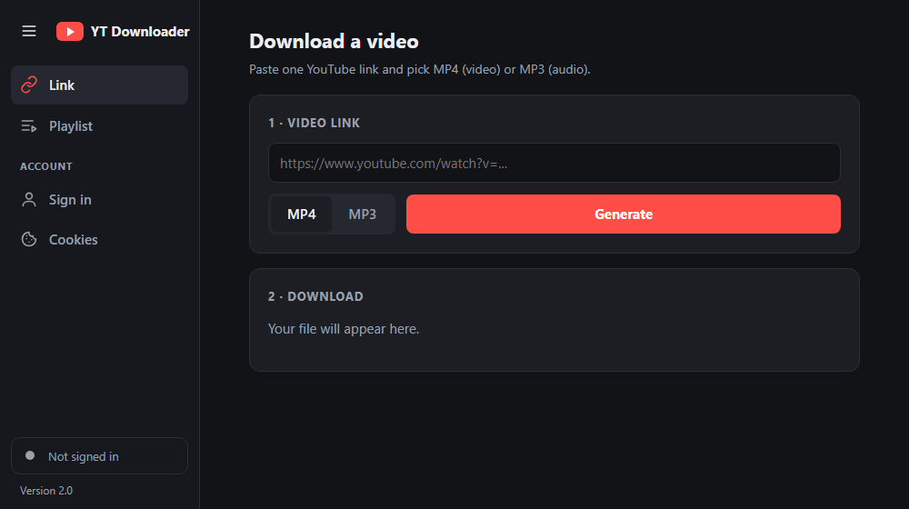

<div align="center">

# 🎬 YouTube Downloader

**Download YouTube videos as MP4 or music as MP3 — single links or whole playlists.**
A small, free Windows app. No install, no ads, no account.


[**⬇️ Download the app**](https://github.com/Ender909v1/YouTube-Downloader/releases/latest)



</div>

---

## ✨ Features

| | |
|---|---|
| 🔗 **Link** | Paste one video link and get a single MP4 or MP3 file. |
| 📃 **Playlist** | Paste a playlist link, or several video links (one per line). Save each file, or everything at once as a **.zip**. |
| 🔞 **Age-restricted videos** | **Sign in** page: sign in to YouTube inside the app, or use your Firefox/Chrome/Edge/Brave sign-in. **Cookies** page: use an exported `cookies.txt`. |
| ⏹️ **Cancel** | Stop a running download or playlist at any time. |
| 📚 **Side menu** | Collapse it to icons or expand it. On narrow windows it slides over the page. |
| 🎵 **MP3** | Best-quality VBR audio (~245 kbps) with title metadata, no clipping. |
| 🎞️ **MP4** | H.264 video + AAC audio, up to 1080p. Plays in the built-in Windows player. |
| 🔢 **Ordered** | Playlist files are numbered in playlist order: `001 - Title.mp3`, `002 - Title.mp3`, … |
| 📦 **All-in-one** | One `.exe` with FFmpeg built in. Nothing else to install. |
| 🌙 **Dark mode** | Follows your Windows light/dark setting. |

## 🚀 Getting started

1. Download **`YouTube Downloader.exe`** from the [latest release](https://github.com/Ender909v1/YouTube-Downloader/releases/latest).
2. Double-click it. The app opens in its own window (first start takes a few seconds).
3. Pick **Link** or **Playlist** in the menu, paste a link, choose **MP4** or **MP3**, and press **Generate**.
4. When it finishes, click **Download** and choose where to save.

### 🔞 Age-restricted videos

YouTube only serves these to a signed-in, age-verified account. Pick one way:

| Way | How | Notes |
|---|---|---|
| **Sign in in this app** | **Sign in** page → **Sign in to YouTube** → accept → sign in on Google's page. | Easiest. You sign in once. Google may sometimes refuse sign-in in app windows. |
| **Browser sign-in** | **Sign in** page → pick your browser. | Works best with Firefox. Newer Chrome/Edge/Brave lock their sign-in, so this often fails. |
| **cookies.txt** | Export cookies for youtube.com with the *Get cookies.txt LOCALLY* extension, then **Cookies** page → choose the file → **Use this file**. | Works with any browser. Export a new file when it expires. |

> [!WARNING]
> Your saved sign-in and any `cookies.txt` file give access to your YouTube account. They stay on your PC and are only sent to YouTube. Never share them. Click **Sign out** on the **Sign in** page to delete the app's saved sign-in.

> [!NOTE]
> The app is not code-signed, so Windows may show **"Windows protected your PC"** the first time.
> Click **More info → Run anyway**.

## 🛠️ Build from source

You need **Windows** and **Python 3.10+**.

```bat
git clone https://github.com/Ender909v1/YouTube-Downloader.git
cd YouTube-Downloader\source
python -m venv .venv
.venv\Scripts\python -m pip install -r requirements.txt
build.bat
```

`build.bat` creates `YouTube Downloader.exe` in the repository root.

Run it without building:

| Mode | Command |
|---|---|
| Desktop window | `.venv\Scripts\python desktop.py` |
| In your browser | `.venv\Scripts\python app.py`, then open <http://127.0.0.1:5000> |

## 📁 Project structure

```
YouTube-Downloader/
├── source/
│   ├── app.py              # Flask server: runs yt-dlp in the background, reports progress, sign-in settings
│   ├── desktop.py          # Native window (pywebview), Save dialog, in-app YouTube sign-in
│   ├── templates/
│   │   └── index.html      # The UI
│   ├── build.bat           # Builds the single-file .exe with PyInstaller
│   └── requirements.txt
└── docs/
    └── screenshot.png
```

## ❓ Troubleshooting

<details>
<summary><b>Downloads suddenly stopped working</b></summary>

YouTube changes often. Update yt-dlp and rebuild:

```bat
cd source
.venv\Scripts\python -m pip install -U yt-dlp
build.bat
```
</details>

<details>
<summary><b>An MP4 plays sound but shows no picture</b></summary>

Files made by older versions may use the AV1 codec. Download them again with the current version (H.264), or install the free **AV1 Video Extension** from the Microsoft Store.
</details>

<details>
<summary><b>Some videos in a playlist are missing</b></summary>

Private, deleted, or age-restricted videos are skipped so the rest of the playlist can still finish.
Sign in (see [Age-restricted videos](#-age-restricted-videos)) to include age-restricted ones.
</details>

<details>
<summary><b>"Sign in to confirm your age" or "Chrome protects its sign-in"</b></summary>

The video is age-restricted. Use **Sign in in this app**, Firefox, or a `cookies.txt` file. Chrome, Edge and Brave lock their sign-in, so the app usually cannot read it directly.
</details>

## 🙏 Built with

- [yt-dlp](https://github.com/yt-dlp/yt-dlp) — the download engine
- [Flask](https://flask.palletsprojects.com/) — local web server for the UI
- [pywebview](https://pywebview.flowrl.com/) — native desktop window
- [imageio-ffmpeg](https://github.com/imageio/imageio-ffmpeg) — bundled FFmpeg
- [PyInstaller](https://pyinstaller.org/) — single-file `.exe`

## ⚠️ Disclaimer

This tool is for personal use. Only download videos you own or have permission to download, and respect [YouTube's Terms of Service](https://www.youtube.com/t/terms) and copyright law.
